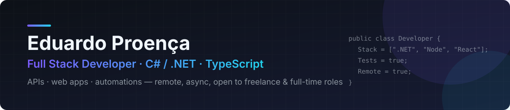
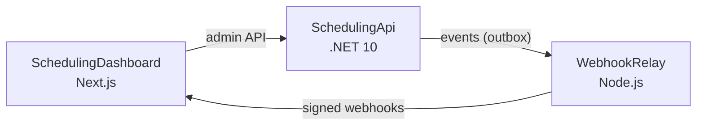

  

  
  
  

## About me

I'm a **full stack developer** from Brazil (UTC-3, overlaps with US hours) working with **C# / .NET** on the backend and **TypeScript, React and Next.js** on the web.

- 💼 Former backend developer at **Qualyteam** (2025): REST APIs in .NET with EF Core and SQL Server, Clean Architecture, DDD and TDD
- 🎓 2.5-year full stack internship at the **Federal Institute of Santa Catarina (IFC)**, leading an ed-tech project and training new interns
- 🚀 Freelance: web systems, APIs and websites for clients in Brazil and abroad
- 💬 Remote, async and written communication. I use AI tools (Claude Code) daily, and I review, test and own every line I ship

## Featured projects

Three projects that work together in production, each with CI, tests and a live demo:

| Project | What it shows | Stack |
|---|---|---|
| [**SchedulingApi**](https://github.com/EduardoCruz78/SchedulingApi) · [live demo](https://scheduling-api-gf47.onrender.com/scalar) | Appointment booking API with real business rules: availability calculation (time zones, DST), double-booking prevention with a PostgreSQL exclusion constraint proven by a concurrency test, JWT roles, transactional outbox, 220 tests | C# · ASP.NET Core 10 · EF Core · PostgreSQL · Testcontainers · Docker |
| [**WebhookRelay**](https://github.com/EduardoCruz78/WebhookRelay) · [live demo](https://webhook-relay-1odf.onrender.com/docs) | Reliable event delivery: idempotent ingestion, at-least-once delivery with exponential backoff and a dead-letter queue, HMAC-signed webhooks, e-mail and Telegram channels, SSRF protection, 356 tests | Node.js 24 · TypeScript · Fastify · PostgreSQL · Drizzle · pg-boss · Vitest |
| [**SchedulingDashboard**](https://github.com/EduardoCruz78/SchedulingDashboard) · [live demo](https://scheduling-dashboard-brown.vercel.app) | Admin dashboard for the API: daily schedule, catalog, KPI charts, relay deliveries and a live feed of signed webhooks; backend-for-frontend security, OpenAPI-typed clients, 130 tests + end-to-end tests of all three services | Next.js 16 · React 19 · TypeScript · Playwright · Vitest |

More projects:

| Project | What it shows | Stack |
|---|---|---|
| [**EduPlatformJS**](https://github.com/EduardoCruz78/EduPlatformJS) · [live demo](https://edu-platform-js-five.vercel.app) | Education platform in a monorepo: Google sign-in, role-based access control, admin panel, audit trail, tests and CI | Next.js · tRPC · Prisma · PostgreSQL · Auth.js · Vitest |
| [**DesafioBackend**](https://github.com/EduardoCruz78/DesafioBackend) | KPI/indicators domain model built test-first: aggregate rules, 12 unit tests, CI on GitHub Actions | C# · .NET 8 · xUnit · FluentAssertions |
| [**Curriculo**](https://github.com/EduardoCruz78/Curriculo) · [live](https://curriculo-psi-drab.vercel.app/en) | Bilingual résumé site designed as a transit map, where each project is a line and the interchanges are the real integrations | Next.js 16 · React 19 · Tailwind CSS 4 · SVG |

## Tech stack

**Backend**
 

**Frontend**
 

**Data, testing & tools**
 

**Practices:** Clean Architecture · Domain-Driven Design · Test-Driven Development · REST API design · Code review

## Let's work together

I'm open to **remote full-time roles** and **freelance/contract projects**: REST APIs, web apps, integrations, automations and bug fixing.
The fastest way to reach me is a message on [LinkedIn](https://www.linkedin.com/in/eduardo-proenca-dev).

🇧🇷 Em português

 

Sou desenvolvedor full stack (C#/.NET e TypeScript/Node.js/React/Next.js). Trabalhei como desenvolvedor backend na Qualyteam, fiz 2 anos e meio de estágio full stack no IFC e atendo projetos freelance. Trabalho 100% remoto, com comunicação por texto. Meus projetos principais formam um sistema que funciona em produção: uma API de agendamentos em .NET, um serviço de entrega de eventos em Node.js e um painel em Next.js, todos com testes, CI e demo online. Estou aberto a vagas e a projetos freelance: me chame no [LinkedIn](https://www.linkedin.com/in/eduardo-proenca-dev).

